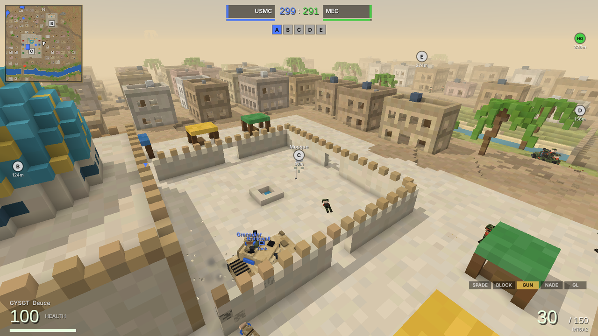
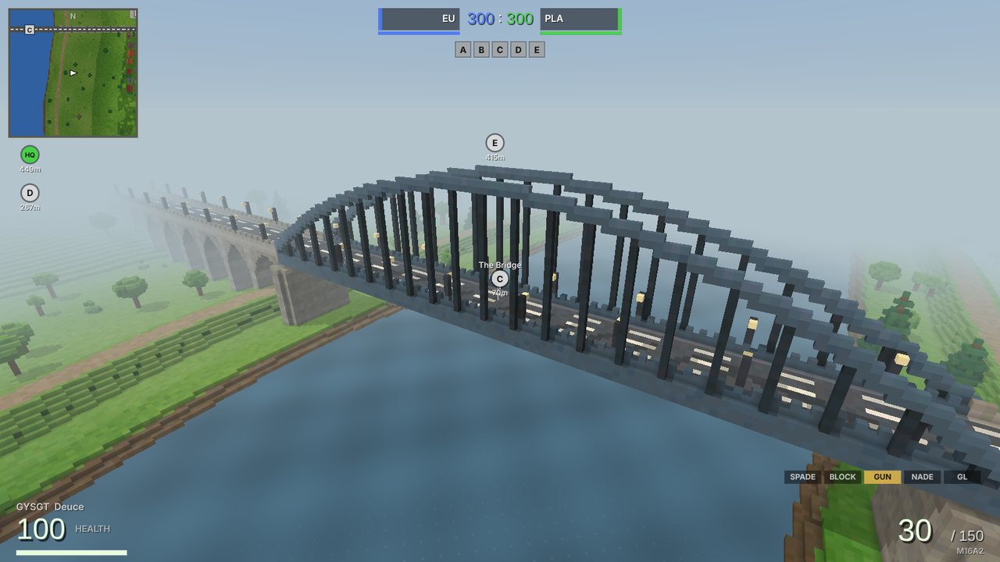
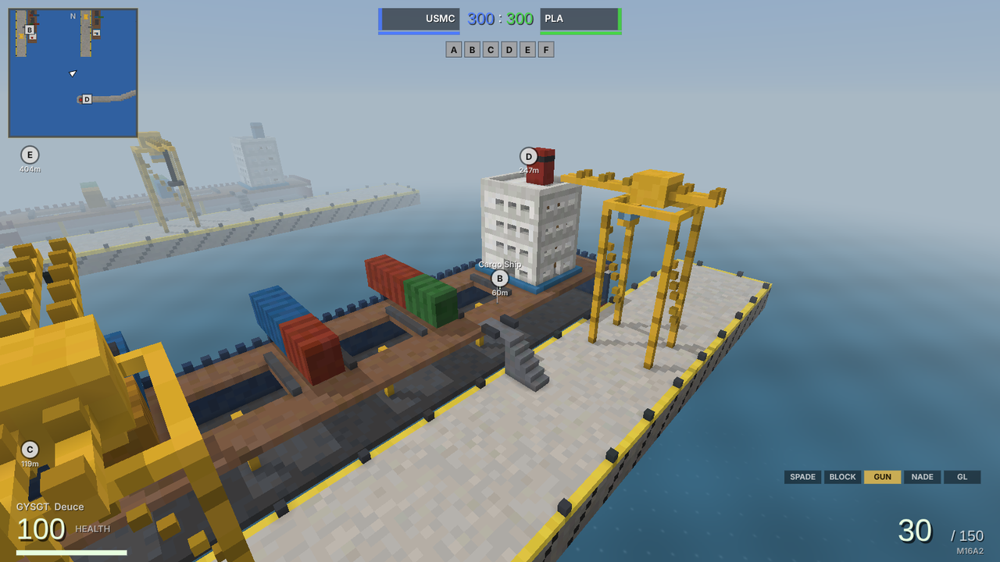
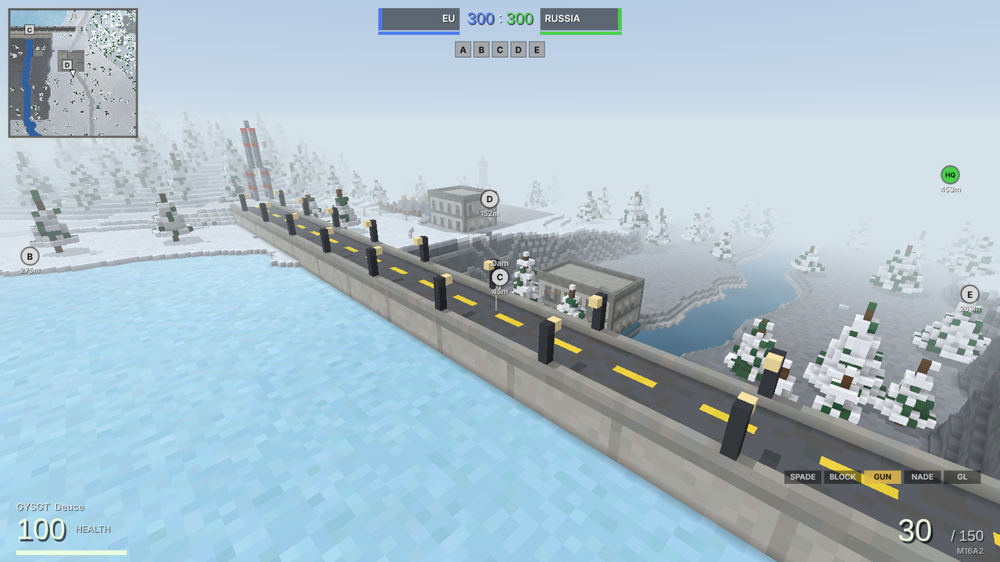
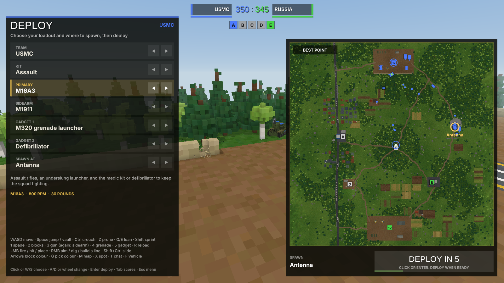
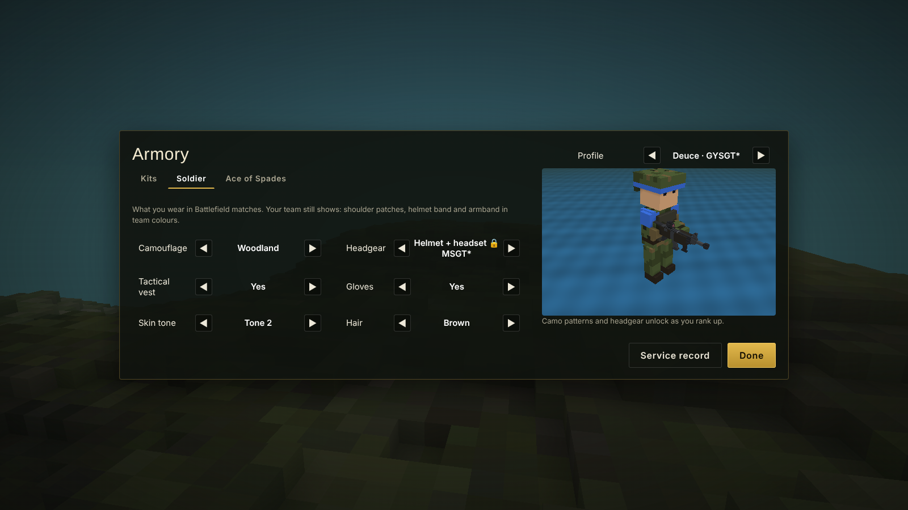

# Battle of Spades

**Current version:** Alpha 0.1.0.3

**Status:** Alpha. Battle of Spades is still being made: new things arrive often, some things will change, and you may meet a bug or two. Your rank, unlocks and loadouts carry over from one version to the next.

## What is it?

Battle of Spades is Ace of Spades 0.75 brought back, then grown into a Battlefield-style war.

At its heart is the classic game, rule for rule: a blocky world under pale blue fog, blue against green. Every block can be dug out with your spade or built back up in any colour, so a hill becomes a trench, a tunnel or a fort while the match is on. Fight with the Rifle, the SMG or the Shotgun, steal the enemy's intel, and hold the command posts.

Then the maps get big. Conquest is fought across land and sea up to 1,024 blocks wide, over flags and tickets, with jeeps, APCs, tanks, anti-air guns, helicopters and boats. Pick a kit for the job, earn ranks, and unlock new weapons, attachments and outfits as you go.

Play on your own against bots that dig, build and tunnel like players do, with up to four people on one screen, or with friends over your home network, online, or on a dedicated server.

## Features

- **Classic Ace of Spades:** the 0.75/0.76 rules, ported from OpenSpades: digging, building with the colour palette, Rifle, SMG, Shotgun and grenades, Capture the Intel and Territorial Control, classic generated maps and any `.vxl` map.
- **Conquest:** Battlefield-style battles on big maps, with flags, tickets and vehicles: jeeps, APCs, tanks, anti-air, attack and transport helicopters, and boats.
- **Kits, ranks and unlocks:** choose a kit, earn points every match, and unlock weapons, attachments and outfits for your soldier.
- **Bots that dig in:** they fight, take flags and drive, and they dig, build walls and bridges and tunnel under you.
- **Split screen for four:** player 1 on keyboard and mouse or a controller, everyone else on a controller.
- **Play together:** host a match for your home network, play online, or run a dedicated server, with a window or without one (a VPS works).
- **A desktop app for Linux and Windows** that keeps itself up to date, or play the game file in any modern browser (WebGL 2).

## Maps

- **Classic maps** (512 × 512, Blue against Green): Classicgen, the original Ace of Spades generator, plus Hallway, Island, Mesa, Trenches and Arena.
- **Random maps:** a new Classicgen, Hills, Islands or City map from any seed, every match if you like.
- **Community maps:** twenty classic maps made by the Ace of Spades community (from [aos-server-mods](https://github.com/1AmYF/aos-server-mods) and [SpadesX](https://github.com/SpadesX/SpadesX)), downloaded the first time you play them and kept. Any `.vxl` map of your own works too.
- **Battlefield maps** (up to 1,024 × 1,024, with vehicles): **Backstab** (USMC against MEC in a desert river town), **A Bridge Too Far** (EU against PLA over a steel arch bridge), **Harbor** (USMC against PLA among the docks and freighters) and **Frostbite** (EU against Russia at a dam in the snow).

Every map plays Capture the Intel, Territorial Control, Team Deathmatch and Conquest.

## Screenshots

| | |
|:-:|:-:|
|  **The main menu** |  **Classic Ace of Spades**: Blue against Green on Classicgen |
|  **Bots dig in**: walls and cover they built during a match |  **The big map**, with the intel, the bases and your team |
|  **Conquest on Backstab**, fighting through the town |  **Backstab's mosque flag** and the town around it |
|  **Vehicles**: transport helicopter, jeep, anti-air, APC and tank |  **A Bridge Too Far**: the flag on the bridge |
|  **Harbor**: a cargo ship you can board |  **Frostbite**: the dam over the frozen reservoir |
|  **Split screen** for up to four players |  **Deploy**: pick your kit, weapon and where to spawn |
|  **The armory**: loadouts and attachments |  **Outfits**: camo, headgear and more, unlocked as you rank up |
|  **Profile & stats**, with your rank and what's next |  **Dedicated server**: a live map of the match |
|  **The desktop launcher**, with the news of every version |  **Launcher options**, with updates from this page |

## Download

Get the newest version from **[Releases](https://github.com/FartGarfunkel/Battle-of-Spades/releases/latest)**:

- **Linux:** `BattleOfSpades-…-x86_64.AppImage`. Make it executable (`chmod +x`, or Properties → Allow executing as program) and run it.
- **Windows:** `BattleOfSpades-…-windows-x64.zip`. Unzip it anywhere and run `BattleOfSpades.exe`. If SmartScreen warns about an unknown app, choose More info → Run anyway.
- **Dedicated server:** `BattleOfSpades-…-server.zip`. Unzip it on any computer with Node.js 18 or newer and run `node bos-server.js --help`. Its `README.txt` explains how to keep it running on a VPS.
- **Just the game:** `battleofspades.html`. Open it in a browser, or install it in the desktop app with Options → Install update…

When a release only changes the game, the desktop apps stay on the release that brought them: its notes say which one.

## Updates

The desktop app checks for a new version each time the launcher opens and installs it by itself. When the app itself changes, Options offers **Update the app**: on Linux the AppImage is replaced where it is, and on Windows the new version is unpacked over the old one when the app restarts.

Your profiles, ranks, unlocks, loadouts and settings are never touched: they're kept in the app's own folder (`~/.config/BattleOfSpades` on Linux, `%APPDATA%\BattleOfSpades` on Windows).

## Dedicated server

- **With a window:** press **Dedicated Server** under Play in the launcher, or start the app with `--server`.
- **Without a window:** `./BattleOfSpades-…-x86_64.AppImage --headless-server --help` on Linux, or `BattleOfSpades-server.cmd --help` in the app's folder on Windows. On a machine with no desktop at all, use the server zip and Node.js.

Servers use TCP port 25590 (or the next free one up to 25599), and announce themselves on the local network on UDP port 25591, so players on the same network see them in the list without typing an address.

## Controls

| Key | Action |
| --- | --- |
| WASD | move |
| Space / Ctrl or C / Shift / V | jump / crouch / sprint / sneak |
| Left click | fire, hit with the spade, place a block, throw a grenade |
| Right click | aim; dig with the spade; build a line of blocks |
| 1 2 3 4 5 | spade, blocks, gun, grenades, your kit's gadget |
| Q | last tool |
| R | reload |
| Arrow keys, G, middle click | choose or pick a block colour |
| E / F | get in or out of a vehicle / change seat (1 to 6 pick a seat) |
| X | third-person view in a vehicle |
| B | change class or loadout |
| Tab / M | scoreboard / big map |
| Z | spot an enemy |
| T / Y | chat / team chat |
| F11 or Alt+Enter | full screen (desktop app) |
| Esc | menu |

Controllers work too: plug in up to four for split screen.

## Source code and building

Battle of Spades is plain JavaScript with no engine and no dependencies. The whole project travels inside the game file: `python3 release/restore.py release/battleofspades.html OUTDIR` rebuilds the project folder from it, `node tools/build.js` builds the game again, and `bash tools/package.sh` builds the desktop apps, the web app and the server zip.

## Credits

- **[OpenSpades](https://github.com/yvt/openspades)** by yvt and its contributors (GPLv3): Battle of Spades is based on its source, and its movement, weapons, building and map code follow it closely.
- **[pyspades](https://github.com/infogulch/pyspades)** and **[piqueserver](https://github.com/piqueserver/piqueserver)**: the server-side rules (damage, respawns, the game modes).
- **Tom Dobrowolski's classicgen** (genland), as ported in pyspades/piqueserver: the classic map generator.
- **The community map makers** whose classic maps the game can download, each credited by name in the game, and the [aos-server-mods](https://github.com/1AmYF/aos-server-mods) and [SpadesX](https://github.com/SpadesX/SpadesX) projects that keep them.
- **Ace of Spades** 0.75 and 0.76, the original game by Ben Aksoy, which all of this sets out to bring back.

Battle of Spades is an unofficial fan project. It is not affiliated with or endorsed by the owners of Ace of Spades or Battlefield; those names belong to their owners.

## License

Battle of Spades is free software: you can redistribute it and/or modify it under the terms of the **GNU General Public License, version 3 or (at your option) any later version** (`GPL-3.0-or-later`). See [LICENSE](LICENSE).
